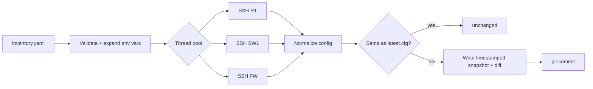

# Python Network Configuration Backup Tool


`netbackup` connects to routers, switches and firewalls over SSH, pulls their running configuration, and stores versioned copies. It also tells you **what changed since the last run**. It works with Cisco IOS/XE/NX-OS/ASA, Arista, Juniper, Fortinet and MikroTik.

```text
$ netbackup -i inventory.yaml --git --show-diff

 [=] R1                   unchanged
 [~] R2                   changed
--- R2/previous
+++ R2/20260930T141502Z
@@ -42,7 +42,7 @@
 interface GigabitEthernet0/2
  description Server LAN
- ip address 172.16.2.1 255.255.255.0
+ ip address 172.16.20.1 255.255.255.0
 [=] R3                   unchanged
 [+] SW1                  new
 [x] EDGE-FW              failed  TCP connection to device failed

5 devices: 1 new, 1 changed, 2 unchanged, 1 failed
```

## Features

- **Parallel backups** over a thread pool (`--workers`), so 100 devices take about as long as the slowest few
- **Noise-free change detection**: timestamps, byte counts and `ntp clock-period` lines are stripped before comparing, so only real config changes show up
- **Unified diffs** for every changed device (`--show-diff`, `--report report.json`)
- **Git history**: `--git` commits each run, giving you `git log` / `git blame` for your network
- **No secrets in files**: credentials come from `${ENV_VARS}` referenced in the inventory
- **Fault isolation**: one unreachable device is logged and skipped, the rest still back up, and the exit code is non-zero for alerting
- **Groups and dry runs**: `--group core` targets a subset, and `--dry-run` validates the inventory without connecting
- **Tested**: pytest suite with a mocked SSH layer, run in GitHub Actions on Python 3.9–3.12

## How It Works



Backups are laid out like this:

```
backups/
├── R1/
│   ├── 20260929T020000Z.cfg
│   ├── 20260930T020000Z.cfg
│   └── latest.cfg
└── SW1/ ...
```

## Quick Start

```bash
git clone https://github.com/abdurrafayk900-ship-it/network-config-backup.git
cd network-config-backup
pip install -e ".[dev]"

cp inventory.example.yaml inventory.yaml
export NET_USER=admin NET_PASS='yourpass' NET_ENABLE='enablepass'

netbackup --dry-run                 # check inventory
netbackup --git --show-diff         # run backups
netbackup --group core --report report.json
```

### Schedule it nightly (cron)

```cron
0 2 * * * cd /opt/network-config-backup && . .env && netbackup --git --report /var/log/netbackup.json
```

## Try It Against the Cisco Lab

The example inventory matches the devices in my [Cisco VLAN & OSPF Network Lab](https://github.com/abdurrafayk900-ship-it/cisco-vlan-ospf-lab). Run the lab in GNS3/EVE-NG, enable SSH, and point `netbackup` at it.

## Running Tests

```bash
pytest -q
```

## Project Structure

```
netbackup/
├── inventory.py   # YAML loading, validation, env-var secrets, per-platform commands
├── backup.py      # SSH fetch, normalization, diff, parallel runner
└── cli.py         # argparse CLI, report output, git integration
tests/             # pytest suite (SSH mocked)
```

## References

- [Netmiko](https://github.com/ktbyers/netmiko) by Kirk Byers
- [Oxidized](https://github.com/ytti/oxidized) and [RANCID](https://shrubbery.net/rancid/): the classic tools this project is modelled on

## License

MIT
